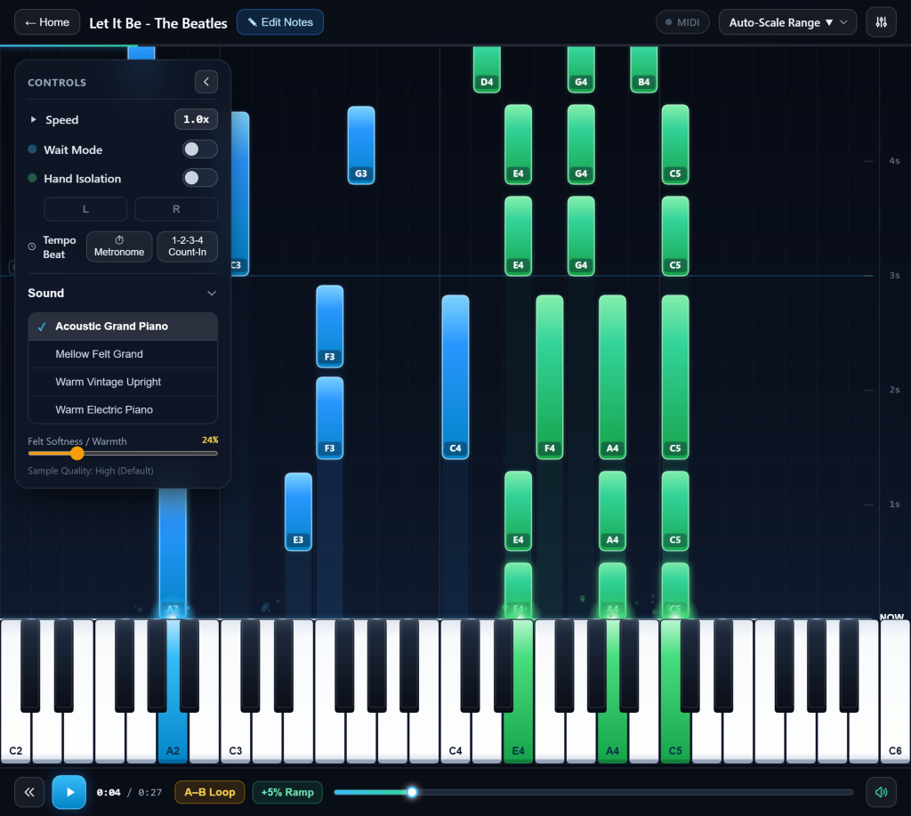
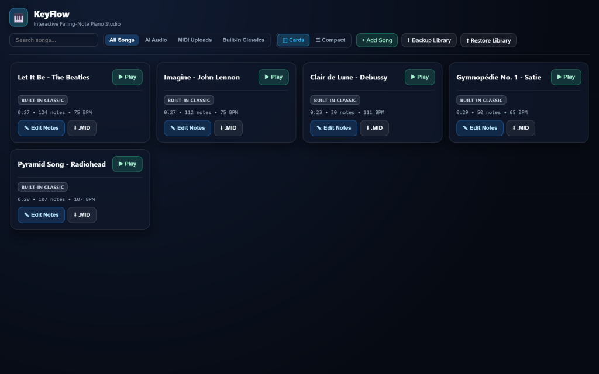
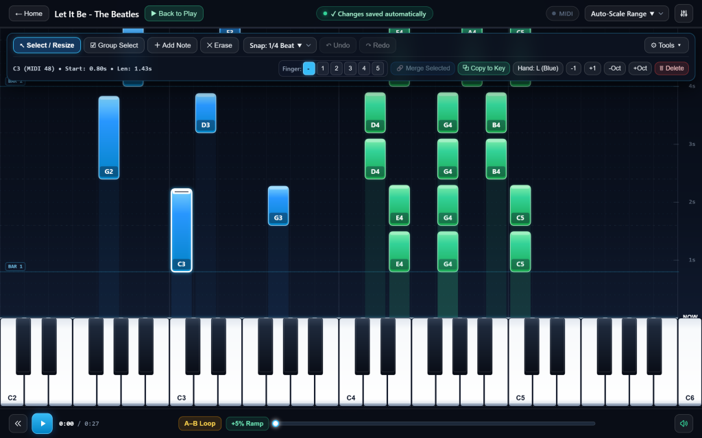

# KeyFlow

**Learn piano songs by actually playing them — without pausing YouTube every three seconds.**

**[Try KeyFlow Live →](https://luizccc-cpu.github.io/KeyFlow/)**

I built KeyFlow to sit on my piano's music stand on a tablet. Most falling-note videos move too fast, don't tell you which notes are coming up, and make you reach for the pause button every time you miss a chord. KeyFlow fixes that: it gives you a steady 5-second heads-up, prints the note name right on every bar, and waits for you when you need a second to find your place.

---

## Why it feels better to practice with

* **No more squinting at tiny keys.** KeyFlow automatically zooms the keyboard to fit only the octaves a song actually uses, so the keys stay wide and easy to read from the piano bench.
* **You always have time to react.** Every note appears 5 seconds before you need to play it — whether you're practicing at half speed or full tempo.
* **Every bar tells you what note it is.** Instead of guessing if a falling bar is an F# or a G, the note name (`C4`, `E4`, `A4`) sits right on the bottom edge of the bar.
* **Blue for left hand, green for right.** Mute either hand whenever you want to practice one side solo while the app plays the other.

---

## Practice tools that actually help you learn

* **Wait Mode:** Turn this on and the song pauses right at the strike line until you hit the right keys. No rushing, no falling behind.
* **Works with your real piano — cables optional:** Plug in a USB or Bluetooth MIDI keyboard, or switch on **Mic Mode** and let your tablet's microphone listen to your acoustic or digital piano.
* **Loop the hard parts and build speed:** Mark a tricky 4-bar section with **A–B Loop** and turn on **+5% Speed Ramp**. Start slow, and every time you get through it cleanly, KeyFlow nudges the tempo up until you're playing at full speed.
* **Live chords, metronome, and count-in:** See the chord name you're playing in real time (`Am`, `Fmaj7`, `G/B`), turn on a soft woodblock metronome, and get a `1–2–3–4` count-in before the notes drop.
* **Four piano sounds built in:** Practice with an **Acoustic Grand**, switch to a cozy **Mellow Felt Grand** for late-night sessions, or try the **Vintage Upright** and **Electric Piano** — plus a warmth slider to dial in the exact tone you like.

---

## Bring your own songs

KeyFlow comes with five classics ready to play (*Let It Be*, *Imagine*, *Clair de Lune*, *Gymnopédie No. 1*, and *Pyramid Song*), and you can add your own in seconds:

* **MIDI files (`.mid`)** — Drop in any MIDI file and KeyFlow automatically splits it into playable left- and right-hand parts.
* **Audio tracks (`.mp3`, `.wav`, `.m4a`)** — Turn a regular song recording into falling piano notes right in the browser (or connect the optional AI transcription server for even cleaner results).

Everything you import or edit stays saved in your browser, and you can back up your whole library to a single file anytime.

---

## Tweak any song right on the screen

Found a wrong note in a MIDI file? Want to move a bass note to your other hand or jot down finger numbers? Tap **Edit Notes** and change it right on the falling-note runway:

Drag notes to move or resize them, draw new ones, flip notes between left and right hand, transpose by semitone or octave, and stamp finger numbers (`1–5`) right onto the bars. Changes save automatically as you go.

---

## Try it out

Open **[KeyFlow](https://luizccc-cpu.github.io/KeyFlow/)** in your browser — no account or install needed.

* **On iPad:** Open the link in **Safari**, tap **Share → Add to Home Screen**, and place your iPad in landscape on the music stand for a clean, full-screen setup.
* **On Android tablets:** Open the link in **Chrome**, tap the **⋮ menu → Add to Home screen** (or **Install app**), and launch it in landscape mode for full-screen practice.
* **On desktop:** Open it in Chrome, Edge, or Safari, plug in a USB MIDI keyboard if you have one, or just hit Play and follow along.

---

Released under the [MIT License](LICENSE).
